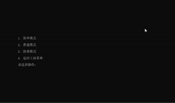
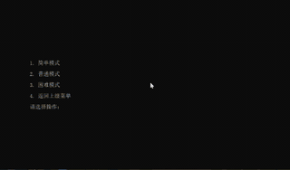
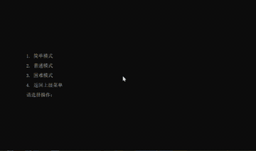
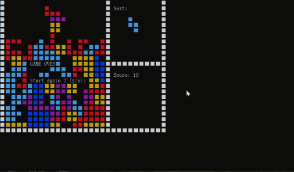

# Russia-Tetris（多人在线字符版俄罗斯方块）

[](https://github.com/22222sss/Russia-Tetris/actions/workflows/build.yml)

## 项目简介

**Russia-Tetris** 是一款基于 Linux 的多人在线俄罗斯方块游戏，客户端通过 Telnet 连接即可游玩，无需安装任何客户端软件。支持登录、注册、成绩查询、排行榜等功能。

**主要功能：**

- **多人在线**：支持多个用户同时在线游戏（各自独立棋盘与节奏，非实时对战）。
- **登录与注册**：通过用户名和密码登录，也可注册新账号。
- **查询成绩**：登录后可查看自己最近 20 次成绩（含难度与分数）。
- **查询排行榜**：查询三种难度下全服 Top10 玩家（用户名、分数、获取时间）。
- **多种难度**：提供简单、普通、困难三种模式。

游戏规则：通过方向键移动、空格键旋转方块，使方块排列成完整的一行或多行并消除得分。

## 技术栈

| 技术 | 说明 |
|------|------|
| libevent | 事件通知库，核心网络框架 |
| spdlog | C++ 日志库 |
| OpenSSL | 密码加盐哈希（PBKDF2-HMAC-SHA256 / 随机盐） |
| Socket | TCP 网络编程 |
| C++17 | 开发语言标准 |

> 注：早期版本基于 epoll 实现事件循环，现已全面迁移至 libevent。

## 目录结构

```
Russia-Tetris/
├── .github/workflows/        # GitHub Actions 自动编译验证（ubuntu / g++）
├── src/                      # 源代码目录
│   ├── Common/               # 通用头文件、宏定义、状态枚举
│   ├── ConnectionPool/       # 用户对象连接池（对象复用与性能优化）
│   ├── EventLoop/            # 核心网络框架（libevent 事件循环）
│   ├── TetrisGame/           # 游戏核心逻辑
│   │   ├── Game.h/.cpp       # 方块移动、旋转、消行、计分等游戏逻辑
│   │   ├── Server.h/.cpp     # 登录与注册逻辑
│   │   ├── User.h/.cpp       # 当前用户信息与状态管理
│   │   ├── PlayerInfo.h/.cpp # 已注册用户信息管理
│   │   ├── PasswordHash.h/.cpp # 密码加盐哈希（PBKDF2）与旧明文迁移
│   │   ├── PasswordPolicy.h  # 注册密码策略（最小长度 / 全空白）
│   │   ├── AuthThrottle.h/.cpp # 登录失败退避（按用户名指数延迟）与哈希队列上限
│   │   ├── IpThrottle.h/.cpp # 按来源 IP 的粗粒度兜底（滑动窗口，挡换用户名喷洒）
│   │   ├── RegThrottle.h/.cpp # 注册限流（每 IP + 全局两道滑动窗口，挡刷号/刷 PBKDF2）
│   │   ├── Db.h/.cpp         # SQLite 存储层（账号 + 成绩）
│   │   └── Filedata.h/.cpp   # 存储/成绩的业务封装（异步读写队列）
│   ├── UImanage/             # 界面管理（TUI）
│   ├── Utility/              # 工具函数与系统优化
│   ├── main.cpp              # 程序入口
│   ├── tetris_admin.cpp      # 管理命令行（重置密码 / 在线备份 / 列表 / 统计）
│   ├── makefile              # 构建脚本
│   └── optimize_system.sh    # 系统调优脚本
├── deploy/                   # 部署入口：SSH 桥 / sshd 片段 / systemd 单元
│   ├── tetris-bridge.py      # 把一条 SSH 会话接到本机 9999（raw/回显/CRLF）
│   ├── sshd-tetris.conf      # sshd Match 片段（ForceCommand 只跑桥）
│   ├── install-ssh-bridge.sh # 幂等安装：桥 + 片段 + 登录账号
│   ├── install-systemd.sh    # 幂等安装：账号 / 目录 / 单元 / sysctl / 开机自启
│   ├── restore-drill.py      # 恢复演练：备份 → 临时实例 → 完整协议（不碰生产库）
│   ├── systemd/              # tetris-game.service + 每日备份 service/timer
│   ├── tetris-backup.sh      # 备份脚本（在线备份 + 保留 N 份）
│   └── sysctl.d/             # listen backlog / 系统 fd 上限
├── Dockerfile                # 多阶段构建、非 root、HEALTHCHECK
├── docker-compose.yml        # 单机部署示例（host 网络 + 两个卷）
├── docs/                     # 交接文档 / 部署上线 / 远程压测 / SSH 承载
├── images-and-gif/           # 演示截图与 GIF
├── tests/                    # 测试与压测脚本（集成 / 跨进程 / 桥 / 部署形态 / 压测）
└── README.md                 # 项目说明
```

## 安装与使用

### 1. 克隆仓库

```bash
git clone git@github.com:22222sss/Russia-Tetris.git
```

### 2. 安装依赖

Ubuntu / Debian 下一条命令安装全部依赖：

```bash
sudo apt update
sudo apt install -y g++ make libevent-dev libspdlog-dev libfmt-dev libssl-dev libsqlite3-dev
```

### 3. 编译

```bash
cd Russia-Tetris/src
make
```

编译成功后会在 `src/` 目录下生成可执行文件 `tetris_game`。

### 4. 运行服务器

```bash
./tetris_game
```

> 首次运行会在当前目录自动创建 SQLite 库 `tetris.db`（账号 + 成绩），无需手工准备；
> 如果目录里有旧版本的 `userdata.csv`，会在**首次启动（空库）时一次性导入**，之后不再使用。

### 5. 管理命令（重置密码 / 备份）

`make` 会一并生成 `tetris-admin`（和 `tetris_game` 同目录）：

```bash
./tetris-admin reset-password alice     # 交互输入新密码（两次，不回显）
./tetris-admin backup                   # 备份到 tetris-backup-<时间>.db（自动 chmod 600）
./tetris-admin list-users               # 账号 / 注册时间 / 是否还是旧明文
./tetris-admin stats                    # 账号数 / 成绩条数 / 各难度最高分
```

- 它和服务端读同一个库（`TETRIS_DB`），**不需要停服**：改密是一条 `UPDATE`，另一个进程
  下次登录立刻生效；已登录的会话不会被踢下线；
- 备份走 SQLite 在线备份接口，WAL 下也是一致快照，完成后会做 `integrity_check`。
  备份文件里是密码哈希，按敏感数据对待；
- 新密码与注册走同一套策略（至少 8 个字符、不能全是空格）；
- 退出码：`0` 成功 / `1` 内部错误 / `2` 用法错误或账号不存在 / `3` 新密码不满足策略。

### 6. 客户端连接

**公网 / 生产环境：走 SSH（推荐）** —— 传输由 SSH 加密，服务端可以只绑回环地址：

```bash
ssh tetris@<服务器IP>
```

一次性的安装（sshd `ForceCommand` + 桥 + 登录账号）见
[docs/SSH_DEPLOY.md](docs/SSH_DEPLOY.md)。装好之后玩家只需要上面这一条命令，
不需要 telnet，也不需要额外客户端。

**内网 / 本机调试：直连 TCP**（明文，只适合可信网络）：

```bash
telnet <服务器IP> 9999
```

- ⚠️ telnet 是**行模式**：方向键要按回车才会发出去，进游戏后基本没法玩，只适合看菜单；
  要正经玩请用上面的 SSH 方式；
- Windows 的 Telnet 客户端默认未启用，需先在「启用或关闭 Windows 功能」中勾选「Telnet 客户端」；
- 查询服务器 IP：Linux 下执行 `ip addr`（`ifconfig` 需先安装 `net-tools`）；
- 端口号位于 `src/Common/Common.h` 的 `DEFAULT_PORT` 宏定义中，默认 9999；
  监听地址由环境变量 `TETRIS_BIND` 控制（默认 `0.0.0.0`，走 SSH 时设成 `127.0.0.1`）。

### 7. 部署上线（systemd / Docker）

生产形态是**公网只开 sshd、服务端只绑回环**（见上一节）。两种部署方式都提供：

```bash
# A) 宿主机 systemd（推荐）：账号/目录/单元/sysctl/开机自启一次装好，幂等
cd src && make -j"$(nproc)" && cd ..
sudo deploy/install-systemd.sh
sudo deploy/install-ssh-bridge.sh     # SSH 入口
sudo passwd tetris                    # 玩家的共享登录口令

# B) Docker：镜像里只有服务端，SSH 入口仍在宿主
docker compose up -d --build
```

装完必须验的四件事（漏了就是线上故障）：

```bash
systemctl show tetris-game -p LimitNOFILE -p LimitNOFILESoft   # 软/硬都应是 300000
ss -ltn | grep 9999                         # 只有 127.0.0.1:9999
systemctl list-timers tetris-backup.timer   # 每天 04:15 在线备份，保留 14 份
journalctl -u tetris-game -n 40             # 启动打印的"生效配置"
sudo tetris-restore-drill /var/backups/tetris/<最新>.db   # 恢复演练（临时端口，不碰生产库）
```

- 日志按大小轮转（`TETRIS_LOG_DIR` / `TETRIS_LOG_MAX_BYTES` / `TETRIS_LOG_MAX_FILES`，
  默认 10 MiB、保留 5 份历史 + 当前文件 ≈ 60 MiB），不再无限增长；
- `LimitNOFILE=300000`、`Restart=always`、`ProtectSystem=strict` 都写在
  `deploy/systemd/tetris-game.service` 里，改之前先读注释；
- 完整步骤、上线 checklist、备份/恢复、升级/回滚、排错表：
  [docs/DEPLOY.md](docs/DEPLOY.md)。

## 项目展示

> GitHub 对 README 内联图片有大小限制，下面的动图为压缩版本（帧率/分辨率有所降低）。


#### 登录注册界面


#### 登录成功后查看最近 20 次成绩与各难度 Top10 排行榜


#### 游戏模式

**简单模式**（方块下降间隔 1 秒）



**普通模式**（方块下降间隔 0.5 秒）



**困难模式**（方块下降间隔 0.2 秒）



#### 游戏结束后返回初始菜单



## 密码存储

账号密码**不以明文落盘**。SQLite 库 `tetris.db` 的 `accounts.password` 保存的是：

```
$pbkdf2-sha256$<迭代次数>$<随机盐 hex>$<摘要 hex>
```

- 算法：PBKDF2-HMAC-SHA256（OpenSSL 实现），默认 10 万次迭代；每个账号 16 字节随机盐，因此相同密码的哈希也不同；
- 校验在**异步线程**进行（PBKDF2 单次几十毫秒，不能占用事件循环线程），并默认用 **2 个哈希线程并行**
  （`TETRIS_HASH_THREADS` 可调，`0`/`1` 关闭）；CI 4 核上 128 个并发登录约 **1.2~1.7 秒**（74~108 次/秒，
  视 runner 而定），对比哈希刚上线时的 3.8 秒；
- **注册密码策略**：至少 **8 个字符**（按 UTF-8 码点计）且不能全是空格；注册时检查，
  老账号的短密码登录不受影响（避免升级一版就把存量用户锁在门外）；
- **登录后可以改密**（主菜单「5. 修改密码」）：输入当前密码和新密码，新密码走**同一套策略**、
  不能与当前密码相同；旧密码错误会计入用户名退避与按 IP 兜底（否则它就是绕过登录限流
  猜密码的旁路）；落盘复用旧明文迁移那条路径（`flock` + 临时文件 + rename，只替换密码字段），
  改完其它 worker 立刻能用新密码登录——**存量短密码由此有了官方出路**；
  注意本项目没有邮箱，"找回密码"只能由管理员重置：`tetris-admin reset-password <用户名>`
  （见上面的「管理命令」一节；不用停服）；
  数据库文件里是密码哈希，权限要按敏感数据处理（别提交进仓库，`.gitignore` 已覆盖 `tetris.db*`）；
- **不泄露账号是否存在**：账号不存在时也会跑一次**随机假凭据**的 PBKDF2（`PasswordHash::verifyDummy`），
  使"账号不存在"和"密码错误"耗时同量级，不能用响应时间枚举账号；
- **登录失败退避**：同一用户名前 **5** 次失败免延迟，之后每次失败延迟翻倍（**1s → 2s → … → 30s 封顶**），
  15 分钟没有新失败就清零；**成功登录立即清零**。窗口内的尝试只被拒绝、**不会延长等待**
  （否则攻击者可以靠反复触发把别人的账号锁死），未知用户名也按同样规则计数。
  同一账号的爆破速度从 ~65 次/秒降到 **~2 次/分钟**；阈值可用 `TETRIS_AUTH_*` 环境变量覆盖；
- **哈希队列上限**：PBKDF2 任务队列最多排 **1024** 个（`TETRIS_AUTH_QUEUE_LIMIT`），
  队满时回"服务繁忙"且**不计入失败次数**，避免登录风暴把内存和延迟拖爆；
- **按来源 IP 兜底**：用户名退避挡不住"换用户名喷洒"（每个新用户名都有 5 次免延迟，
  攻击者还能用不存在的用户名逼服务端跑假 PBKDF2）。这里再按 IP 封一层：
  **5 分钟滑动窗口内失败 300 次**（`TETRIS_AUTH_IP_MAX_FAILURES` / `_WINDOW_MS`）后，
  该 IP 的登录尝试在**读凭据/跑 PBKDF2 之前**就被拒绝，单源最多约 **1 次哈希/秒**；
  阈值放宽是为了照顾 NAT（同一个出口后面可能有几十个玩家）。被拒绝的尝试**不记账、
  不延长窗口**（否则攻击者能把整个 NAT 锁死），成功登录也**不清零**
  （注册是开放的，清了就等于给攻击者一个重置开关）；
- **注册限流**：注册是唯一"免费"的 PBKDF2 入口（不需要旧密码），而且它的哈希跑在**唯一的
  异步写线程**上（和登录凭据查询 / 成绩写入同一条队列）。所以在**提交哈希之前**挡两道
  5 槽滑动窗口：单个 IP **5 分钟 20 次**（`TETRIS_REG_IP_MAX` / `_WINDOW_MS`）+ 全进程
  **1 小时 200 次**（`TETRIS_REG_GLOBAL_MAX` / `_WINDOW_MS`，挡"换 IP 喷洒"）；
  被拒绝的尝试不记账，密码不满足策略/用户名重复（没进哈希）也不占额度；
- **旧数据自动迁移**：升级前遗留的明文密码仍可登录，登录成功后会在 `flock` 临界区内就地改写成哈希（临时文件 + rename，多进程安全），之后按新格式校验；
- 老账号在首次登录前仍是明文——这是有意的渐进迁移，避免启动时对所有账号做一次昂贵的全量重哈希。

> 这两层退避状态和注册限流都是**每进程**的：多 worker 时阈值实际 ×N（默认 1 worker 不受影响）。
> `tests/auth_throttle_test.cpp` / `tests/ip_throttle_test.cpp` / `tests/reg_throttle_test.cpp`
> 用注入时间覆盖指数增长/封顶/清零/过期/窗口内不延长/条目上限（IP 与注册那层还有
> 滑动窗口/多 IP 隔离/全局额度）等边界。

`tests/password_hash_test.cpp` 用 Python `hashlib` 生成的已知向量交叉验证哈希实现，并覆盖
假凭据校验（恒失败 + 耗时同量级）与注册密码策略；集成测试（12 项）断言"注册落盘的是这个密码的加盐哈希"、
"短密码注册被拒"、"未知账号与错误密码提示一致"、"连续失败后进入退避、等待结束可正常登录"、
"改密后新密码可登录、旧密码失效"、"旧明文账号登录后完成迁移"；跨进程测试（5 项）里还有
"一个进程改密、另一个进程用新密码登录"；`tests/ip_fallback_test.py` 用低阈值服务端验证
"换用户名喷洒被按 IP 拦住、另一个源地址同时可正常登录、窗口滑过后恢复"；
`tests/reg_limit_test.py` 用低阈值服务端验证"单 IP 用完额度被拦、换 IP 仍可注册、
全局额度用完后全新 IP 也被拦、窗口滑过后恢复"。

## 并发性能测试

服务端程序的核心指标之一是**并发连接数**。本项目提供了自动化压测脚本 `tests/load_test.py` 与 `tests/bench.sh`，并在 GitHub Actions 的 4 核 / 16 GB runner 上做了实测。

**测试方法**

- 使用 Python asyncio 编写压测客户端，通过两个 loopback IP（`127.0.0.1` / `127.0.0.2`）各承担一半连接，突破单 IP 约 6.4 万个源端口的限制。
- 客户端分批建立 TCP 连接，连接成功后读取服务端下发的欢迎界面，验证数据收发是否正常。

**如何复现**

在一台 Linux 机器上（连接数越大，对 CPU、文件描述符上限和内核参数要求越高）：

```bash
git clone git@github.com:22222sss/Russia-Tetris.git
cd Russia-Tetris
sudo apt install -y g++ make libevent-dev libspdlog-dev libfmt-dev libssl-dev libsqlite3-dev python3
bash tests/bench.sh 100000 5000 30 1 2
```

第 5 个参数是压测客户端进程数：目标连接数会按进程拆分，各进程分别绑定 `127.0.0.1`、`127.0.0.2` …，最后合并结果。压测端 CPU 不够时（例如 4 核机器）把它设为 2 及以上可以显著提高成功率。

> 编译默认使用 **`-O2`**（`OPT ?= -O2`）；要复现 `-O0` 时代的数据用 `make clean && make OPT=-O0`，
> 连接压测也可以用 `BENCH_OPT=-O0` / `-O2` 做级别的 A/B。**不同优化级别的数字不能混比。**

> 要验证**多核收益**必须让服务端和压测端跑在不同机器上（同机会抢 CPU）。现成的远程游戏负载脚本与买机/判读手册见 [docs/REMOTE_BENCH.md](docs/REMOTE_BENCH.md)。

`bench.sh` 会自动调整 `ulimit -n` 与内核参数、编译、启动服务端、执行压测，并采样服务端 RSS / fd / CPU，结果写入 `bench-results/<时间戳>/`（`result.json`、`result.txt`、`summary.md`）。

也可以手动执行（`--pid` 指定服务端进程即可采样其资源占用）：

```bash
python3 tests/load_test.py 100000 5000 1 30 --pid "$(pgrep -f tetris_game)" --json result.json
```

> 客户端与服务端同机时，压测客户端本身也会占用 CPU 和文件描述符；失败会按 timeout / refused / reset / bind 失败 / fd 耗尽等原因分类，便于判断瓶颈在服务端还是压测端。

**实测结果（GitHub Actions，4 核 / 16 GB）**

用本仓库的 `bench` workflow 在免费 runner 上复测（`bash tests/bench.sh 100000 5000 30 1 2` 为 10 万 / 双客户端；20 万档为 `200000 10000 30 1 4`）：

| 指标 | 10 万 / 单客户端 | 10 万 / 双客户端 | **20 万 / 四客户端** |
|------|------|------|------|
| 成功建立 | 70,674（70.7%） | **100,000（100%）** | **172,891（86.5%）** |
| 失败 | 29,326（全部 timeout） | **0** | 27,109（全部 timeout） |
| 总耗时 | 457 秒 | **124 秒** | 248 秒 |
| 建立速率 | 155 连接/秒 | **804 连接/秒** | 697 连接/秒 |
| 服务端 CPU | 19.9% | 18.5% | **58.4%** |
| 服务端 RSS | 681.6 MB | 771.1 MB | **1376.2 MB** |
| 服务端 fd 峰值 | 83,292 | 99,737 | **180,959** |

> 上表是**棋盘改 int8 之前**的数据（`sizeof(User)` = 6304 字节）。改后 `sizeof(User)` = 1984 字节，
> 同机 A/B 实测 8.5 万连接 **RSS 687.6/698.1 MB → 329.5/330.4 MB（-52%）**，
> 10 万连接约 350~370 MB；连接池预创建再瘦身后峰值不变（详见 [docs/HANDOVER.md](docs/HANDOVER.md) 4.8/4.9）。

**结论**

- 免费 4 核 runner 上，10 万连接可 **100% 建立**（双客户端进程，124 秒，804 连接/秒）。
- 20 万档建立 **172,891** 个连接（86.5%），服务端 fd 峰值 18.1 万、RSS 1.38 GB、CPU 58.4%。
- 压测端（单进程客户端）会先于服务端成为瓶颈；服务端在 17 万连接时仍有约 40% 单核余量。
- **30 万连接尚未达成**：免费 4 核/16G runner 上最高 **182,375（60.8%）**，失败全是客户端连接超时；
  此时服务端只用了 1.27 GB / 53% 单核，瓶颈在压测客户端。按 20 万线性外推，30 万约需 2.1 GB RSS
  和 30 万 fd，服务端容量够，但需要更多压测端机器才能验证。

**性能优化**

实测过程中定位并修复了一个关键性能缺陷：两个 100ms 定时器回调通过 `getAllUsers()` **按值返回复制整个用户 map**，连接数越多，每次回调复制的 `shared_ptr` 就越多，导致服务端 CPU 占用升高、数据下发延迟。改为锁内遍历（`forEachUser`）后不再复制整张表，定时器开销也不再随连接数线性放大。

此外还应用了以下优化：

1. **异步日志**：`spdlog` 异步工厂 + 大队列（65536）+ 2 个写线程，生产环境 `warn` 级别，消除同步写盘阻塞。
2. **清屏优化**：清屏最初是 240 次小 `send`，先合并为一次发送，后又改为 ANSI 清屏码 `\x1b[2J\x1b[H`（7 字节）替代逐行空格输出，单次清屏数据量下降几个数量级；当前代码只保留 ANSI 方案。
3. **去掉 GBK 转换**：移除每次输出时的 `utf8_to_gbk`（iconv）转换，直接发送 UTF-8。
4. **正确处理 EAGAIN**：非阻塞 socket 发送缓冲区满时不再误关连接。
5. **输出批量（2026-11-01）**：一次按键/一次重力重绘原本要 20~30 次 `send`（每个方块格子 3 次：定位/颜色/文本），
   现在用 `OutputBatch` 把一次事件处理内的所有输出攒进发送缓冲，结束时合并成 **1 次 `send`**。
   同样 200 玩家负载下，服务端 CPU **114.2% → 51.4%**（1 worker），2/4 worker 也从 155/163% 降到 75/78%；
   按键速率和下行不降反升（8.0k → 8.3k 按键/秒，3.08 → 3.33 MB/s）。
6. **构建优化 -O2（2026-11-01）**：默认编译选项从 `-O0 -g` 改成 **`-O2 -g`**（`make OPT=-O0` 可复现旧基线）。
   在同一台 runner 上交错跑 -O0/-O2 各两轮（200 玩家 × 20s，1 worker）：
   **游戏窗口 CPU 14.3% → 10.3%（-28%），每次按键 14.8 → 10.7 µs（-28%）**，按键/下行不变。
   这里的 CPU 只统计"所有玩家都在按键"的窗口，**不含登录 PBKDF2**——那段是 OpenSSL 的汇编实现，
   不受 -O2 影响，把它算进来会把收益从 28% 稀释到 13%（详见 [docs/HANDOVER.md](docs/HANDOVER.md) 4.7）。
7. **`User` 内存（2026-11-01）**：棋盘 `data`/`color` 从 `int[24][30]` 改成**有符号 `int8_t`**
   （`color` 用 -1 表示空位），**`sizeof(User)` 6304 → 1984 字节**，10 万连接的用户对象 601 MB → 189 MB。
   同机 A/B（同一 runner，改前/改后各两轮）：
   - **10 万连接目标（实测约 8.5 万建立）服务端 RSS 687.6/698.1 MB → 329.5/330.4 MB（-52%）**；
   - 200 玩家场景 RSS **396.6 → 190.6 MB**——连接池启动预创建 5 万个 `User`，小负载下池才是内存大头；
   - 游戏窗口 CPU 无变化（12.4/12.5% vs 12.6/11.2%，噪声内）。
   `User.h` 还加了 `static_assert(sizeof(User) <= 2048)`，防止结构体悄悄涨回去
   （详见 [docs/HANDOVER.md](docs/HANDOVER.md) 4.8）。
8. **连接池预创建 50000 → 2048（2026-11-01）**：每个 `User` 除了 1984B 对象还有两个空 deque 约 1.15KB 堆，
   5 万个预创建就是 ~150MiB——服务器哪怕只有 200 个玩家也要常驻这么多，而建连实测只占 ~16% 单核
   （池空时按需 `new` 一个 `User` 只要 2~3µs）。
   同机 A/B：**200 玩家 RSS 190.4 → 41.1 MB（-78%）**，10 万连接**峰值 RSS 基本不变**
   （308/334 → 319/322 MB），成功率/CPU/速率无退化。
   池子会涨到峰值（`MAX_POOL_SIZE = 100000`），但**空闲时会 trim 回 4096 个**
   （`TETRIS_POOL_TRIM_TARGET`，默认 5 秒检查一次），跑过 10 万连接后那 ~300MB 缓存
   最多留几秒；trim 只丢空闲对象，不影响在线连接（详见 [docs/HANDOVER.md](docs/HANDOVER.md) 4.9 与 5.连接池收缩）。

> 口径提醒：上面的历史数字（51.4%、114.2% 等）是"全程 CPU"（含登录哈希），**不能和 -O2 的
> 游戏窗口口径直接相除**。当前代码的每按键成本按窗口口径是 -O0 约 15 µs、-O2 约 11 µs。

**剩余瓶颈**

- **单线程事件循环**：默认单进程单线程，accept 与数据处理在同一线程内串行。已实现多进程 worker（`TETRIS_WORKERS=N`，每个 worker 独立 `event_base` + `SO_REUSEPORT`），但**在纯建连场景下测不出收益**（见下）。
- **后期建立速率下降**：连接数较大时建立速率会下降（主要发生在客户端读取欢迎数据阶段），根因仍需 profiling。

**多进程 worker 实测（10 万连接 / 双客户端 / 4 核 runner）**

| 配置 | 成功率 | 建立速率 | 服务端 CPU（占满一核 = 100%） |
|---|---|---|---|
| 1 worker | 99.6% | 629 连接/秒 | 30.4% |
| 1 worker + `SO_REUSEPORT` | 99.0% | 518 连接/秒 | 27.6% |
| 2 worker | 81.2% | 484 连接/秒 | 28.0% |
| 4 worker | 84.8% | 608 连接/秒 | 21.7% |

- **服务端不是瓶颈**：10 万空闲连接只消耗约 21%~30% 的**单核**，多核没有可压榨的余量，所以 worker 数对建连吞吐没有影响（瓶颈在压测客户端）。
- 表中 2/4 worker 的成功率偏低（81%~85%）**不是 worker 或 `SO_REUSEPORT` 造成的**。把同一配置放到干净 runner 上作为第一轮跑，成功率同样是 ~99%；连续第二次跑才掉到 ~81%。根因是压测客户端连续建连时无法复用 `TIME_WAIT` 端口（`tests/load_test.py` 已补上 `SO_REUSEADDR`）。
- 结论：**多进程 worker 在这类场景下既没测出收益，也没测出代价**。因此默认仍是 `TETRIS_WORKERS=1`，多进程能力留给"单连接 CPU 开销高"的真实游戏负载。

**游戏负载实测（200 玩家真实登录 + 开局 + 持续按键，20 秒；历史数据：-O0 + 全程口径）**

`tests/play_test.py` 会让每个连接真的走完 登录 → 开始游戏 → 选难度，然后持续按方向键（只按左/右，不按下键，避免提前 GAME OVER）。

| 配置 | 按键速率 | 服务端下行 | 服务端 CPU（占满一核 = 100%） | RSS |
|---|---|---|---|---|
| 1 worker | 9,575 按键/秒 | 3,861 KB/s | **51.2%** | 393 MB |
| 2 worker | 9,087 按键/秒 | 3,652 KB/s | 63.7% | 427 MB |
| 4 worker | 9,210 按键/秒 | 3,708 KB/s | 71.6% | 487 MB |

- 每次按键服务端都要 `strcmp` + 整屏重绘（每个方块格子 3 次 `send`，约 20~30 次；已合并为 1 次）。
  按"游戏窗口"口径（不含登录哈希）实测**每次按键约 15 µs CPU**（-O0）/ **约 11 µs**（-O2），
  即 1 万按键/秒只占 **0.10~0.15 单核**，单 worker 线性外推到 6~9 万按键/秒才会打满一核
  （实际会先被压测客户端限住，`play_test.py` 按 0.02s 间隔定时发，上限约 1 万/秒）。
- 这个负载下单个 worker 只用了 ~0.1 核，**加 worker 不提吞吐（反而略降），CPU 却更高**——多进程自身（每进程一份 100ms 定时器、epoll、进程调度）的开销超过了收益。
- **单机 4 核无法证明多核收益**：压测客户端和服务端抢同一批核心，要压到服务端饱和，客户端本身就得吃掉大半 CPU。真要做这个结论需要多机压测（`BENCH_REMOTE_CLIENTS`）。
- 附带观察（已收口）：2/4 worker 时玩家就绪数曾略降（199 → 189/191），当时怀疑是登录阶段的文件锁争用。
  后续登录路径优化（O(1) 凭据查找 + 哈希线程池）后复测，**1/2/4 worker 均 200/200 就绪**。

> 上表是**输出批量优化之前**的数据，而且是 `-O0` + "全程 CPU"（含登录哈希）的口径；
> 其中的 RSS 也是棋盘改 int8、连接池瘦身之前的值（现在 200 玩家约 41 MB，见“连接池预创建”）。
> 把一次按键/一次重力重绘的 20~30 次 `send` 合并成 1 次后，
> 同样 200 玩家负载下服务端 CPU 约减半（1 worker 114.2% → **51.4%**，2/4 worker 155/163% → 75/78%），
> 按键速率和下行不降反升，详见上方“输出批量”。
> 改为 `-O2` 后（同一 runner 交错 A/B）游戏窗口 CPU 再降 28%，见“构建优化 -O2”。

## 致谢

`Russia-Tetris` 的诞生离不开开源软件和社区的支持，感谢以下开源项目及项目维护者：

- spdlog：https://github.com/gabime/spdlog
- libevent：https://github.com/libevent/libevent
- 业务参考项目：https://blog.csdn.net/chenlong_cxy/article/details/119680671

## 支持一下

如果觉得这个项目还不错，点个 ⭐ Star，这将是对 **Russia-Tetris** 极大的鼓励与支持。

## 许可证

本项目采用 [MIT 许可证](LICENSE)。
