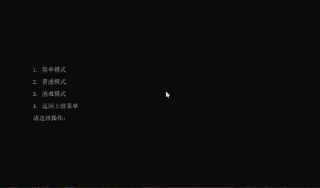
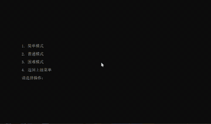
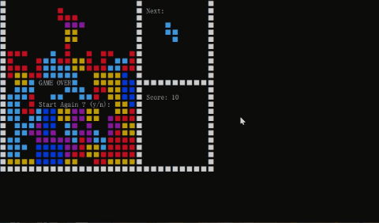

# Russia-Tetris（多人在线字符版俄罗斯方块）

[](https://github.com/22222sss/Russia-Tetris/actions/workflows/build.yml)

## 项目简介

**Russia-Tetris** 是一款基于 Linux 的多人在线俄罗斯方块游戏，客户端通过 Telnet 连接即可游玩，无需安装任何客户端软件。支持登录、注册、成绩查询、排行榜等功能。

**主要功能：**

- **多人在线**：支持多个用户同时在线游戏（各自独立棋盘与节奏，非实时对战）。
- **登录与注册**：通过用户名和密码登录，也可注册新账号。
- **查询成绩**：登录后可查看自己最近 20 次成绩（含难度与分数）。
- **查询排行榜**：查询三种难度下全服 Top10 玩家（用户名、分数、获取时间）。
- **多种难度**：提供简单、普通、困难三种模式。

游戏规则：通过方向键移动、空格键旋转方块，使方块排列成完整的一行或多行并消除得分。

## 技术栈

| 技术 | 说明 |
|------|------|
| libevent | 事件通知库，核心网络框架 |
| spdlog | C++ 日志库 |
| OpenSSL | 密码加盐哈希（PBKDF2-HMAC-SHA256 / 随机盐） |
| Socket | TCP 网络编程 |
| C++17 | 开发语言标准 |

> 注：早期版本基于 epoll 实现事件循环，现已全面迁移至 libevent。

## 目录结构

```
Russia-Tetris/
├── .github/workflows/        # GitHub Actions 自动编译验证（ubuntu / g++）
├── src/                      # 源代码目录
│   ├── Common/               # 通用头文件、宏定义、状态枚举
│   ├── ConnectionPool/       # 用户对象连接池（对象复用与性能优化）
│   ├── EventLoop/            # 核心网络框架（libevent 事件循环）
│   ├── TetrisGame/           # 游戏核心逻辑
│   │   ├── Game.h/.cpp       # 方块移动、旋转、消行、计分等游戏逻辑
│   │   ├── Server.h/.cpp     # 登录与注册逻辑
│   │   ├── User.h/.cpp       # 当前用户信息与状态管理
│   │   ├── PlayerInfo.h/.cpp # 已注册用户信息管理
│   │   ├── PasswordHash.h/.cpp # 密码加盐哈希（PBKDF2）与旧明文迁移
│   │   └── Filedata.h/.cpp   # userdata.csv 数据读写
│   ├── UImanage/             # 界面管理（TUI）
│   ├── Utility/              # 工具函数与系统优化
│   ├── main.cpp              # 程序入口
│   ├── makefile              # 构建脚本
│   └── optimize_system.sh    # 系统调优脚本
├── images-and-gif/           # 演示截图与 GIF
├── tests/                    # 压测脚本（load_test.py / bench.sh）
└── README.md                 # 项目说明
```

## 安装与使用

### 1. 克隆仓库

```bash
git clone git@github.com:22222sss/Russia-Tetris.git
```

### 2. 安装依赖

Ubuntu / Debian 下一条命令安装全部依赖：

```bash
sudo apt update
sudo apt install -y g++ make libevent-dev libspdlog-dev libfmt-dev libssl-dev
```

### 3. 编译

```bash
cd Russia-Tetris/src
make
```

编译成功后会在 `src/` 目录下生成可执行文件 `tetris_game`。

### 4. 运行服务器

```bash
./tetris_game
```

> 首次运行若当前目录没有 `userdata.csv`，服务端会自动创建带表头的空数据文件，无需手工准备。

### 5. 客户端连接

在客户端终端（cmd / PowerShell / Linux 终端）输入：

```bash
telnet <服务器IP> 9999
```

- Windows 的 Telnet 客户端默认未启用，需先在「启用或关闭 Windows 功能」中勾选「Telnet 客户端」，或改用 Linux 终端 / PuTTY。
- 查询服务器 IP：Linux 下执行 `ip addr`（`ifconfig` 需先安装 `net-tools`）。
- 端口号位于 `src/Common/Common.h` 的 `DEFAULT_PORT` 宏定义中，默认 9999，可自行修改。

## 项目展示

> GitHub 对 README 内联图片有大小限制，下面的动图为压缩版本（帧率/分辨率有所降低）。


#### 登录注册界面


#### 登录成功后查看最近 20 次成绩与各难度 Top10 排行榜


#### 游戏模式

**简单模式**（方块下降间隔 1 秒）


**普通模式**（方块下降间隔 0.5 秒）



**困难模式**（方块下降间隔 0.2 秒）



#### 游戏结束后返回初始菜单



## 密码存储

账号密码**不以明文落盘**。`userdata.csv` 的 `Password` 列保存的是：

```
$pbkdf2-sha256$<迭代次数>$<随机盐 hex>$<摘要 hex>
```

- 算法：PBKDF2-HMAC-SHA256（OpenSSL 实现），默认 10 万次迭代；每个账号 16 字节随机盐，因此相同密码的哈希也不同；
- 校验在**异步线程**进行（单次约几十毫秒，不能占用事件循环线程），事件循环只负责收发与渲染；
- **旧数据自动迁移**：升级前遗留的明文密码仍可登录，登录成功后会在 `flock` 临界区内就地改写成哈希（临时文件 + rename，多进程安全），之后按新格式校验；
- 老账号在首次登录前仍是明文——这是有意的渐进迁移，避免启动时对所有账号做一次昂贵的全量重哈希。

`tests/password_hash_test.cpp` 用 Python `hashlib` 生成的已知向量交叉验证哈希实现，集成测试则断言"注册落盘的是这个密码的加盐哈希"和"旧明文账号登录后完成迁移"。

## 并发性能测试

服务端程序的核心指标之一是**并发连接数**。本项目提供了自动化压测脚本 `tests/load_test.py` 与 `tests/bench.sh`，并在 GitHub Actions 的 4 核 / 16 GB runner 上做了实测。

**测试方法**

- 使用 Python asyncio 编写压测客户端，通过两个 loopback IP（`127.0.0.1` / `127.0.0.2`）各承担一半连接，突破单 IP 约 6.4 万个源端口的限制。
- 客户端分批建立 TCP 连接，连接成功后读取服务端下发的欢迎界面，验证数据收发是否正常。

**如何复现**

在一台 Linux 机器上（连接数越大，对 CPU、文件描述符上限和内核参数要求越高）：

```bash
git clone git@github.com:22222sss/Russia-Tetris.git
cd Russia-Tetris
sudo apt install -y g++ make libevent-dev libspdlog-dev libfmt-dev libssl-dev python3
bash tests/bench.sh 100000 5000 30 1 2
```

第 5 个参数是压测客户端进程数：目标连接数会按进程拆分，各进程分别绑定 `127.0.0.1`、`127.0.0.2` …，最后合并结果。压测端 CPU 不够时（例如 4 核机器）把它设为 2 及以上可以显著提高成功率。

`bench.sh` 会自动调整 `ulimit -n` 与内核参数、编译、启动服务端、执行压测，并采样服务端 RSS / fd / CPU，结果写入 `bench-results/<时间戳>/`（`result.json`、`result.txt`、`summary.md`）。

也可以手动执行（`--pid` 指定服务端进程即可采样其资源占用）：

```bash
python3 tests/load_test.py 100000 5000 1 30 --pid "$(pgrep -f tetris_game)" --json result.json
```

> 客户端与服务端同机时，压测客户端本身也会占用 CPU 和文件描述符；失败会按 timeout / refused / reset / bind 失败 / fd 耗尽等原因分类，便于判断瓶颈在服务端还是压测端。

**实测结果（GitHub Actions，4 核 / 16 GB）**

用本仓库的 `bench` workflow 在免费 runner 上复测（`bash tests/bench.sh 100000 5000 30 1 2` 为 10 万 / 双客户端；20 万档为 `200000 10000 30 1 4`）：

| 指标 | 10 万 / 单客户端 | 10 万 / 双客户端 | **20 万 / 四客户端** |
|------|------|------|------|
| 成功建立 | 70,674（70.7%） | **100,000（100%）** | **172,891（86.5%）** |
| 失败 | 29,326（全部 timeout） | **0** | 27,109（全部 timeout） |
| 总耗时 | 457 秒 | **124 秒** | 248 秒 |
| 建立速率 | 155 连接/秒 | **804 连接/秒** | 697 连接/秒 |
| 服务端 CPU | 19.9% | 18.5% | **58.4%** |
| 服务端 RSS | 681.6 MB | 771.1 MB | **1376.2 MB** |
| 服务端 fd 峰值 | 83,292 | 99,737 | **180,959** |

**结论**

- 免费 4 核 runner 上，10 万连接可 **100% 建立**（双客户端进程，124 秒，804 连接/秒）。
- 20 万档建立 **172,891** 个连接（86.5%），服务端 fd 峰值 18.1 万、RSS 1.38 GB、CPU 58.4%。
- 压测端（单进程客户端）会先于服务端成为瓶颈；服务端在 17 万连接时仍有约 40% 单核余量。

**性能优化**

实测过程中定位并修复了一个关键性能缺陷：两个 100ms 定时器回调通过 `getAllUsers()` **按值返回复制整个用户 map**，连接数越多，每次回调复制的 `shared_ptr` 就越多，导致服务端 CPU 占用升高、数据下发延迟。改为锁内遍历（`forEachUser`）后不再复制整张表，定时器开销也不再随连接数线性放大。

此外还应用了以下优化：

1. **异步日志**：`spdlog` 异步工厂 + 大队列（65536）+ 2 个写线程，生产环境 `warn` 级别，消除同步写盘阻塞。
2. **清屏优化**：清屏最初是 240 次小 `send`，先合并为一次发送，后又改为 ANSI 清屏码 `\x1b[2J\x1b[H`（7 字节）替代逐行空格输出，单次清屏数据量下降几个数量级；当前代码只保留 ANSI 方案。
3. **去掉 GBK 转换**：移除每次输出时的 `utf8_to_gbk`（iconv）转换，直接发送 UTF-8。
4. **正确处理 EAGAIN**：非阻塞 socket 发送缓冲区满时不再误关连接。

**剩余瓶颈**

- **单线程事件循环**：默认单进程单线程，accept 与数据处理在同一线程内串行。已实现多进程 worker（`TETRIS_WORKERS=N`，每个 worker 独立 `event_base` + `SO_REUSEPORT`），但**在纯建连场景下测不出收益**（见下）。
- **后期建立速率下降**：连接数较大时建立速率会下降（主要发生在客户端读取欢迎数据阶段），根因仍需 profiling。

**多进程 worker 实测（10 万连接 / 双客户端 / 4 核 runner）**

| 配置 | 成功率 | 建立速率 | 服务端 CPU（占满一核 = 100%） |
|---|---|---|---|
| 1 worker | 99.6% | 629 连接/秒 | 30.4% |
| 1 worker + `SO_REUSEPORT` | 99.0% | 518 连接/秒 | 27.6% |
| 2 worker | 81.2% | 484 连接/秒 | 28.0% |
| 4 worker | 84.8% | 608 连接/秒 | 21.7% |

- **服务端不是瓶颈**：10 万空闲连接只消耗约 21%~30% 的**单核**，多核没有可压榨的余量，所以 worker 数对建连吞吐没有影响（瓶颈在压测客户端）。
- 表中 2/4 worker 的成功率偏低（81%~85%）**不是 worker 或 `SO_REUSEPORT` 造成的**。把同一配置放到干净 runner 上作为第一轮跑，成功率同样是 ~99%；连续第二次跑才掉到 ~81%。根因是压测客户端连续建连时无法复用 `TIME_WAIT` 端口（`tests/load_test.py` 已补上 `SO_REUSEADDR`）。
- 结论：**多进程 worker 在这类场景下既没测出收益，也没测出代价**。因此默认仍是 `TETRIS_WORKERS=1`，多进程能力留给"单连接 CPU 开销高"的真实游戏负载。

**游戏负载实测（200 玩家真实登录 + 开局 + 持续按键，20 秒）**

`tests/play_test.py` 会让每个连接真的走完 登录 → 开始游戏 → 选难度，然后持续按方向键（只按左/右，不按下键，避免提前 GAME OVER）。

| 配置 | 按键速率 | 服务端下行 | 服务端 CPU（占满一核 = 100%） | RSS |
|---|---|---|---|---|
| 1 worker | 9,575 按键/秒 | 3,861 KB/s | **51.2%** | 393 MB |
| 2 worker | 9,087 按键/秒 | 3,652 KB/s | 63.7% | 427 MB |
| 4 worker | 9,210 按键/秒 | 3,708 KB/s | 71.6% | 487 MB |

- 每次按键服务端都要 `strcmp` + 整屏重绘（约 8~10 次 `send`）。实测 **1 万按键/秒 ≈ 0.51 核**，即**每次按键约 0.05 ms CPU**。
- 这个负载下单个 worker 才用了半核，**加 worker 不提吞吐（反而略降），CPU 却更高**——多进程自身（每进程一份 100ms 定时器、epoll、进程调度）的开销超过了收益。
- **单机 4 核无法证明多核收益**：压测客户端和服务端抢同一批核心，要压到服务端饱和，客户端本身就得吃掉大半 CPU。真要做这个结论需要多机压测（`BENCH_REMOTE_CLIENTS`）。
- 附带观察：2/4 worker 时玩家就绪数略降（199 → 189/191），怀疑与多进程共享 `userdata.csv` 时的 `flock` 争用有关（登录时会拿共享锁），未进一步定位。

## 致谢

`Russia-Tetris` 的诞生离不开开源软件和社区的支持，感谢以下开源项目及项目维护者：

- spdlog：https://github.com/gabime/spdlog
- libevent：https://github.com/libevent/libevent
- 业务参考项目：https://blog.csdn.net/chenlong_cxy/article/details/119680671

## 支持一下

如果觉得这个项目还不错，点个 ⭐ Star，这将是对 **Russia-Tetris** 极大的鼓励与支持。

## 许可证

本项目采用 [MIT 许可证](LICENSE)。
